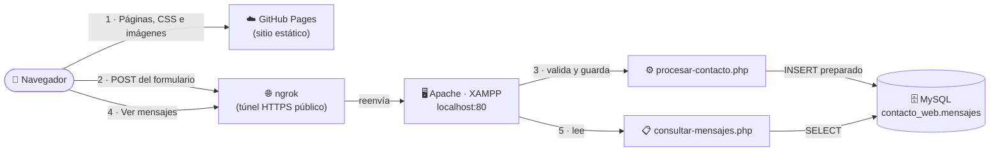

# 🃏 BFRZ · Sitio de póker con formulario de contacto

> **Práctica 01 · Programación y Plataformas Web** · Universidad Politécnica Salesiana
> Sitio web con HTML5, CSS3 y un formulario de contacto integrado con **PHP 8.2 + MySQL** (XAMPP).


---

## 📖 Descripción

**BFRZ** es un sitio temático de póker que explica las siglas *Bet · Fold · River · Zzz*, las reglas, el ranking de manos, torneos, glosario, historia y jugadores.

La parte de contacto permite enviar un mensaje que se **valida en el servidor**, se **guarda en MySQL** y se **consulta** desde una página PHP.

## 🧭 ¿Cómo funciona? (flujo de la aplicación)

El sitio combina dos servicios, porque **GitHub Pages solo sirve archivos estáticos** (HTML, CSS, imágenes) y **no ejecuta PHP**:



**Paso a paso:**

1. **GitHub Pages** entrega `index.html`, `pages/*.html`, `css/estilos.css` e imágenes. Es la cara pública del sitio.
2. Al pulsar **Enviar**, el navegador hace un `POST` a la URL de **ngrok**, que contiene `procesar-contacto.php`. ngrok crea una dirección pública que reenvía a tu XAMPP.
3. **Apache** ejecuta `procesar-contacto.php`, que valida los campos, y si todo está bien guarda el mensaje en MySQL con una **consulta preparada**.
4. La página **consultar-mensajes.php** también se abre por ngrok y muestra los registros de la tabla.

> ⚠️ **Importante:** el formulario y la consulta solo funcionan mientras **XAMPP (Apache y MySQL) y ngrok estén encendidos** en el equipo que hospeda el servidor. GitHub Pages no reemplaza a XAMPP, solo sirve la parte estática.

## 📁 Estructura del proyecto

```text
PracticaWeb_HTML/
├── index.html                  # Página de inicio
├── pages/
│   ├── contacto.html           # Formulario (POST → ngrok)
│   ├── procesar-contacto.php   # Validación + INSERT con MySQLi
│   ├── consultar-mensajes.php  # Tabla con los mensajes guardados
│   ├── reglas.html · manos.html · torneos.html · glosario.html
│   └── historia.html · ecuador.html · ranking-jugadores.html
├── css/
│   └── estilos.css             # Hoja de estilos única (sin frameworks)
├── php/
│   └── conexion.php            # Conexión MySQLi a contacto_web
├── sql/
│   └── contacto_web.sql        # Script para crear la base y la tabla
├── images/                     # Imágenes, SVG y fotos de jugadores
├── audio/ · video/             # Recursos multimedia
└── informe/                    # Informe técnico y capturas de pruebas
```

## ✅ Requisitos

| Herramienta | Versión probada | Para qué |
|---|---|---|
| XAMPP | 8.2.4 (macOS, Apple Silicon) | Apache + PHP 8.2 + MySQL |
| Navegador | Chrome | Pruebas |
| ngrok | 3.x | Exponer Apache a internet |

## ⚙️ Instalación local (XAMPP)

**1. Copiar el proyecto a `htdocs`**

```bash
git clone https://github.com/BrandonFRZ-cki/PracticaWeb_HTML.git \
  /Applications/XAMPP/xamppfiles/htdocs/PracticaWeb_HTML
```

**2. Iniciar Apache y MySQL** desde el panel de XAMPP.

**3. Crear la base de datos.** Abre `http://localhost/phpmyadmin`, pestaña **SQL**, y ejecuta el contenido de `sql/contacto_web.sql`.

**4. Revisar la conexión** en `php/conexion.php`. Por defecto usa:

```php
$servidor = 'localhost';
$usuario  = 'root';
$clave    = '';           // XAMPP viene sin contraseña en root
$base     = 'contacto_web';
```

> Si cambias el usuario o la contraseña de MySQL, actualiza estos valores.

**5. Verificar que el sitio carga:** `http://localhost/PracticaWeb_HTML/index.html`

## 🌐 Ejecución con ngrok

```bash
ngrok config add-authtoken TU_TOKEN
ngrok http --url=https://TU-DOMINIO.ngrok-free.app 80
```

Después, en `pages/contacto.html`, el formulario debe apuntar a tu URL:

```html
<form action="https://TU-DOMINIO.ngrok-free.app/PracticaWeb_HTML/pages/procesar-contacto.php" method="post">
```

> ℹ️ Con el plan gratuito de ngrok, si el dominio no es fijo la URL cambia cada vez. Actualiza el `action` y vuelve a publicar en GitHub Pages.

## 🛡️ Validación y seguridad

- **Cliente:** atributos `required`, `maxlength`, `type="email"`.
- **Servidor (obligatoria):** `trim()` para rechazar cadenas vacías o solo con espacios, `filter_var(FILTER_VALIDATE_EMAIL)`, longitudes con `mb_strlen`.
- **Base de datos:** consultas preparadas con `bind_param`, para evitar inyección SQL.
- **Salida:** `htmlspecialchars()` en cada dato que se imprime, para mostrarlo como texto.

## 🎨 CSS

La hoja `css/estilos.css` está organizada con comentarios por sección: variables de color, base y herencia, tipografía, cabecera, navegación, contenido, tarjetas, tablas, formulario y pie.

- **Flexbox:** diseño en dos columnas (`.cuerpo`), tarjetas con `flex-wrap`, cabecera y pie.
- **Estados:** `:hover`, `:active` y `:focus` en la navegación, los botones y los campos.
- **Adaptable:** `@media` para pantallas de 800 px y 600 px.

## 🧪 Pruebas

Se ejecutaron los casos **P1 a P8** del enunciado. El detalle de cada caso, con su acción, resultado esperado, resultado obtenido y captura, está en el informe técnico: [`informe/`](informe/).

## 👤 Autor

**Brandon Fernando Rivera Zambrano**
Computación · Programación y Plataformas Web · UPS Ecuador

---

<p align="center"><sub>Hecho con ♥ y muchas fichas · BFRZ · Bet · Fold · River · Zzz ♠ ♥ ♦ ♣</sub></p>
